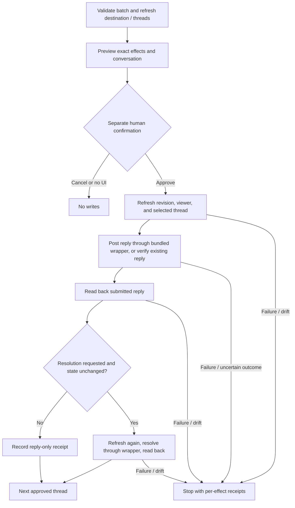

# Guarded review responses

## Intent and scope

Complete `/review-respond` with portable GitHub feedback retrieval and guarded
inline-thread replies/resolution. The approved scope is a read-only feedback tool,
a batch response tool, wrapper-backed writes, tests, and workflow documentation.
No worktree management, service startup, live GitHub writes during development,
general-comment posting, review dismissal, commit, or push automation is included.

A user triages a PR, approves fixes separately, and then inspects one response
batch. Each thread receives its own reply; GitHub does not provide an atomic
multi-thread reply-and-resolve transaction. A partial round must retain receipts
and stop, not roll back other people's conversations or resend everything.

## Domain and invariants

- Destination: explicit configured host, base repository, PR number and node ID.
- Revision: full head and base SHAs. Changing either invalidates publication.
- Thread: opaque GraphQL node ID verified as belonging to the selected PR.
- Conversation version: deterministic digest of complete thread metadata and all
  comments, including IDs, bodies, edit times, publication state, and authorship.
- Actor: authenticated viewer observed through GitHub, unchanged across a round.
- Reply: exact approved text plus a deterministic per-reply marker. Only a matching
  submitted reply authored by the authenticated viewer can be reused automatically.
- Existing reply: explicitly selected published response in that same thread,
  previewed with its content; it can support resolution without posting another.
- Resolution: separately named in the batch; allowed only after a verified posted
  or existing reply, current permission, and unchanged conversation/revision.

The adapter verifies destination, state, and publication, not semantic correctness
or local test execution. The skill/user still decides whether every concern was
addressed, a fix was validated/pushed, and resolution is appropriate.

## Retrieval

`github_review_feedback` retrieves PR identity, all inline threads and their
comments, review summaries, and ordinary discussion comments. Pagination covers
outer lists and nested comment connections independently. Null/malformed nodes,
GraphQL errors, missing permission/state fields, changing totals/identity, cursor
loops, and resource-budget exhaustion fail closed rather than returning a complete
flag for partial material. Output is bounded; larger PRs need an explicit handoff.

Use authenticated `gh` with explicit hostname and literal argument arrays. Read
queries may use GraphQL POST transport but contain only fixed query operations.
No token handling, arbitrary endpoints, supplied GraphQL, or shell evaluation.
The existing review adapter remains unchanged except shared target normalization.

## Publication protocol

`github_respond_to_review` accepts pinned head/base SHAs and a bounded list of
unique thread actions. Each action includes the retrieved conversation version,
exact reply text or an existing reply ID, and an explicit resolution boolean.

Previewed mutation payloads, including client identifiers, must remain identical
to submitted payloads even after an earlier effect changes the conversation.
Preview edits invalidate approval. Absent UI, cancellation and rejection never
write. Rechecks run before every mutation, not just at batch start. New objections
or edits after a reply prevent subsequent resolution. Unknown write outcomes are
reconciled read-only when possible, never automatically retried; even a reconciled
transport failure stops the remaining batch. Each attempted effect has an outcome,
and untouched actions remain not-started. Cancellation preserves confirmed earlier
receipts and does not claim nothing happened after submission began.

Duplicate markers include actor, target, revisions, thread and exact body, but not
the conversation digest, so a refreshed recovery round can reuse its earlier reply.
A copied marker from another actor or altered body is not a matching receipt.
Resolution-only recovery explicitly selects a verified published reply. Neither
marker detection nor `clientMutationId` is server-side idempotency. Reads and writes
are not transactional; a change can race the final check, and this limit must be
visible. Do not attempt automatic unresolve, delete, or corrective publication.

## Implementation slices and proof

1. Pure schemas, parsing, conversation versions, and fixed query/mutation payloads.
   Validate against the official GitHub schema; test malformed input, node-ID
   confusion, duplicate threads, edited content and actor-bound markers.
2. Bounded read shell. Test pagination of every channel and nested comments,
   identity drift, permission/GraphQL errors, repeated cursors, and budgets.
3. Approved batch execution and transport. Test preview/cancel/headless behavior,
   per-effect rechecks, reply-only, resolution-only, duplicates, partial rounds,
   wrong receipts, cancellation and ambiguous outcomes. The fake CLI must intercept
   every call; the Bash transport is exercised without network access.
4. Register tools and update skill/docs/package checks. Verify type/lint/format,
   complete suite, SDK loading, Markdown links, package inclusion and coverage.

## External contract and limits

The public GitHub GraphQL schema defines `AddPullRequestReviewThreadReplyInput`
(body, thread ID, optional client mutation ID) and `ResolveReviewThreadInput`
(thread ID and optional client mutation ID). Use separate fixed mutations and
JSON-file input through the transport wrapper, with independently checked readback.

Sources consulted during implementation:

- [GitHub public schema](https://docs.github.com/public/fpt/schema.docs.graphql)
- [GitHub CLI API transport and pagination](https://cli.github.com/manual/gh_api)

Older Enterprise schemas or insufficient credentials may reject fields/mutations;
report incompatibility without weakening checks. Automated provider simulations
are not a live-host smoke. Release verification still needs separately authorized
reply/resolution smoke tests on disposable PRs on each intended host.
